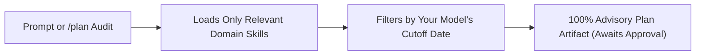

# 🌌 GeminiPostCutoff

[](https://github.com/CostaCloudSA/GeminiPostCutoff/actions/workflows/audit.yml)
[](LICENSE)
[](skills/gcp-skills-index/SKILL.md)
[](skills/gcp-skills-index/SKILL.md)

Post-cutoff **Google Cloud Platform (GCP)** & **AI Agent** architectural runbooks for **Google Antigravity** and **Gemini CLI**.

Built to complement Google's **[Developer Knowledge MCP](https://developers.google.com/knowledge/api)** (`developerknowledge.googleapis.com/mcp`): while Developer Knowledge lets your agent **look up** official documentation on demand, `GeminiPostCutoff` **proactively flags** architectural anti-patterns, service retirements, cross-service trade-offs (`Security > Reliability > Performance > FinOps`), and practitioner FinOps cost traps.



---

## ⚙️ How It Works

* **Zero-Bloat Progressive Disclosure**: Antigravity indexes only lightweight skill descriptions at startup. Full runbooks (`SKILL.md`) and dated reference vaults (`references/articles.md`) load on-demand only when your prompt or stack requires them.
* **Model-Aware Cutoff Filtering**: Every reference is tagged with its publication month and year (`[MM.YY]`). Based on which Gemini model you use ([`config/model_cutoffs.json`](config/model_cutoffs.json)), the system automatically prioritizes features released *after* your model's training cutoff, double-checks syntax from the 12 months right before its cutoff (where Preview and GA syntax often get mixed up), and uses older references strictly for timeless FinOps math. If your model isn't confirmed, it safely defaults to the oldest active model (`gemini-3.1-pro`, Jan 2025 cutoff) so no recent changes are missed.
* **100% Advisory Governance ([`rules/AGENTS.md`](rules/AGENTS.md))**: Never modifies your Terraform, Kubernetes, IAM, or application files autonomously. Always generates a cited **Implementation Plan Artifact** and waits for your approval (`Proceed`).

---

## ⚡ Quick-Start Setup

```bash
# Option 1: Global Antigravity Plugin (Recommended — mounts rules, 23+ skills, and auditor subagent):
git clone https://github.com/CostaCloudSA/GeminiPostCutoff.git ~/.gemini/config/plugins/GeminiPostCutoff

# Option 2: Team Workspace Submodule (shared across a project repo):
git submodule add https://github.com/CostaCloudSA/GeminiPostCutoff.git .agents/plugins/GeminiPostCutoff

# Option 3: Local Installer Script (Plugin or Flat Skill Symlinks):
pwsh scripts/install.ps1              # Windows (append -FlatSkills for symlinks)
bash scripts/install.sh               # Linux/macOS (append --flat-skills for symlinks)
```

* **Selective Domain Mounting**: Load only specific skills in a workspace via `.agents/skills.json` (`include_only: ["gcp-gemini-enterprise", "gcp-adk-agents", "gcp-cloud-run", ...]`).
* **Pair with Google Developer Knowledge MCP**: Merge [`mcp_config.example.json`](mcp_config.example.json) into `~/.gemini/config/mcp_config.json` to combine live official Google docs with `GeminiPostCutoff` FinOps and SRE guardrails.

---

## 🗂️ Architectural Pillars (10 Pillars · 23+ Domain Skills)

| Pillar | Domain Skills (`skills/<domain>/SKILL.md`) | Core Post-Cutoff Coverage & FinOps Guardrails |
| :--- | :--- | :--- |
| **1. Gemini Enterprise** | [`gcp-gemini-enterprise`](skills/gcp-gemini-enterprise/SKILL.md) | Gemini Enterprise & Gemini Enterprise Agent Platform (GEAP), Agent Compute Engine & expanded governance, GEAR program, Gemini Managed Agents, Agent Gateway, Custom Connectors & Terraform |
| **2. AI Agents, ADK, Multimodal & Tooling** | [`gcp-adk-agents`](skills/gcp-adk-agents/SKILL.md) · [`gcp-conversational-ai`](skills/gcp-conversational-ai/SKILL.md) · [`gcp-generative-media`](skills/gcp-generative-media/SKILL.md) · [`gcp-gemini-tooling`](skills/gcp-gemini-tooling/SKILL.md) | ADK (Python/Go/TS/Java/Kotlin), Agent Engine, A2A/A2UI/AG-UI, Memory Bank, Dynamic MCP Discovery, Gemini Live Voice Agents, Veo 3.1 & Omni Flash, Antigravity IDE, Gemini CLI & `gcloud` Remote MCP |
| **3. Frontier & Edge AI (Gemma & TPUs)** | [`gcp-frontier-emerging`](skills/gcp-frontier-emerging/SKILL.md) | Gemma open model family (Gemma 4 12B, EmbeddingGemma 2 MRL truncation, Gemma 3, PaliGemma), Edge/On-Device AI (LiteRT, WebGPU, MediaPipe), Cloud TPU v5p/v6e JAX FSDP, HBM tuning, SFT & biotech AI |
| **4. Google Kubernetes Engine (GKE)** | [`gcp-gke-platform`](skills/gcp-gke-platform/SKILL.md) · [`gcp-gke-inference`](skills/gcp-gke-inference/SKILL.md) · [`gcp-gke-cost`](skills/gcp-gke-cost/SKILL.md) | Autopilot & Standard, Gateway API (`ingress-nginx` retirement), Dataplane V2, Pod Snapshots, ComputeClasses, CPU Startup Boost, GKE Inference Gateway (vLLM/Ray/Kueue), Agent Sandbox, GKE Cost Allocation & VPA |
| **5. GCP Classical Compute, Messaging, Networking & Databases** | [`gcp-cloud-run`](skills/gcp-cloud-run/SKILL.md) · [`gcp-computefinops`](skills/gcp-computefinops/SKILL.md) · [`gcp-pubsub`](skills/gcp-pubsub/SKILL.md) · [`gcp-networking`](skills/gcp-networking/SKILL.md) · [`gcp-databases`](skills/gcp-databases/SKILL.md) | Cloud Run (`--no-cpu-throttling`, Compose, IAP, Temporal), Compute Engine (U4 low-latency, Flex-start VMs, Spend Caps, CUDs), Pub/Sub (SMTs, Bigtable/BQ/GCS zero-ETL sinks, Managed Kafka), Direct VPC Egress & IPAM, Cloud SQL, AlloyDB ScaNN, Firestore Pipelines & Spanner |
| **6. BigQuery & Looker Analytics** | [`gcp-bigquery-ai`](skills/gcp-bigquery-ai/SKILL.md) · [`gcp-bigquery-analytics`](skills/gcp-bigquery-analytics/SKILL.md) · [`gcp-bigquery-cost`](skills/gcp-bigquery-cost/SKILL.md) | BigQuery AI (`ObjectRef`, `TimesFM 3.0`, `VECTOR_SEARCH`, Autonomous Embeddings, Remote MCP, Knowledge Catalog), Looker & Conversational Analytics semantic layer, Dataform & dbt, BigQuery Graph, Iceberg, 690 TB/mo slot crossover, 90-day storage DML rules & daily AI token quotas |
| **7. Cloud & Data Warehouse Migrations** | [`gcp-migrations`](skills/gcp-migrations/SKILL.md) | AWS/Azure to GCP mapping, Snowflake/Teradata/Databricks to BigQuery (AI dbt migration skills & ADK Cortex bridge), zero-code MongoDB to Firestore Enterprise cutover, Database Migration Service (DMS) |
| **8. Geospatial & Earth Observation** | [`gcp-geospatial`](skills/gcp-geospatial/SKILL.md) | Google Earth Engine AI-assisted geospatial coding, AlphaEarth satellite embeddings, BigQuery GIS (`ST_*`), and Google Maps Platform pipelines |
| **9. Emerging Technologies (Robotics & Android XR)** | [`gcp-gemini-robotics`](skills/gcp-gemini-robotics/SKILL.md) · [`gcp-android-xr`](skills/gcp-android-xr/SKILL.md) | Gemini Robotics Embodied Reasoning 2 (`gemini-robotics-er-2.0`), Physical AI with NVIDIA Isaac Sim & Aloha Sim, on-device robotic manipulation, Android XR SDK & Jetpack XR Compose spatial computing |
| **10. Security, Compliance & Governance** | [`gcp-security-compliance`](skills/gcp-security-compliance/SKILL.md) · [`gcp-architecture-review`](skills/gcp-architecture-review/SKILL.md) · [`gcp-skills-index`](skills/gcp-skills-index/SKILL.md) | Google Model Armor, Workload Identity Federation (WIF), IAM Helper Agent Skills, Sensitive Data Protection for Vertex AI, Context Window secret hygiene, Multi-Domain Architecture Audit Orchestrator & Master Router |

---

## 💬 Feedback & License

* **Issues & Article Nominations**: Found an erratum or want to nominate a recent Google Cloud engineering post? [Open a GitHub Issue](https://github.com/CostaCloudSA/GeminiPostCutoff/issues).
* **License**: Licensed under the **Apache License, Version 2.0**. See [LICENSE](LICENSE) for details. Copyright (c) 2026 [CostaCloudSA](https://github.com/CostaCloudSA).
