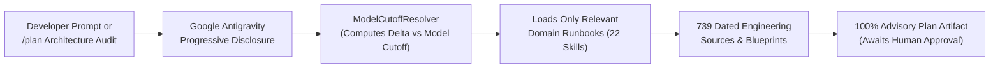

# 🌌 GeminiPostCutoff: Post-Cutoff Google Cloud & AI Agent Runbooks for Antigravity

[](https://github.com/CostaCloudSA/GeminiPostCutoff/actions/workflows/audit.yml)
[](https://github.com/CostaCloudSA/GeminiPostCutoff/actions/workflows/monthly_link_check.yml)
[](LICENSE)
[](skills/gcp-skills-index/SKILL.md)
[](skills/gcp-skills-index/SKILL.md)
[](https://github.com/CostaCloudSA)

**`GeminiPostCutoff`** is an on-demand architectural knowledge system and deterministic review engine for **Google Antigravity** and **Gemini CLI**. It bridges the gap between your AI model's training freeze and today's production **Google Cloud Platform (GCP)** & **AI Agent** ecosystem.

---

## 🎯 Why `GeminiPostCutoff`?

Every LLM has a static training cutoff (for example, **January 2025** for `gemini-3.1-pro` or **March 2026** for `gemini-3.8-flash` and `gemini-4-argon`). Meanwhile, Google Cloud ships critical architectural changes every month—such as **Vertex AI ADK 1.0**, **Cloud Run Direct VPC Egress**, **GKE Gateway API**, **BigQuery Remote MCP**, and **Pub/Sub Lite's March 2026 retirement**.

Without post-cutoff grounding, AI coding assistants frequently recommend deprecated CLI flags, legacy SDK patterns, or costly FinOps anti-patterns. `GeminiPostCutoff` solves this natively inside Antigravity:



1. **Zero-Bloat Progressive Disclosure**: Antigravity indexes only lightweight skill descriptions at startup. Full domain runbooks (`SKILL.md`) and dated reference vaults (`references/articles.md`) load on-demand only when your prompt or codebase requires them.
2. **Cutoff-Relative Dynamic Triage ($\Delta_m$)**: Rather than relying on static tiers or hardcoded model defaults, `GeminiPostCutoff` dynamically computes the exact post-cutoff delta ($\Delta_m > 0$) and 12-month maturation window ($-12 \le \Delta_m \le 0$) for **Newest** (`gemini-4-argon`, custom `--cutoff YYYY-MM`) and **Older** (`gemini-3.8-flash`, `gemini-3.1-pro`) models.
3. **100% Advisory `/plan` Gate**: Enforces [`rules/AGENTS.md`](rules/AGENTS.md) so the agent never autonomously modifies your Terraform, Kubernetes, database, or IAM files without first generating an **Implementation Plan Artifact** with clickable citations and exact code diffs for your approval.

---

## ⚡ 30-Second Antigravity Setup

Choose the integration pattern that matches how you use **Google Antigravity**:

| Setup Mode | Antigravity Mechanism | Target Path | Best For |
| :--- | :--- | :--- | :--- |
| **1. Global Plugin (Recommended)** | Native Plugin Bundle ([`plugin.json`](plugin.json) + `rules/` + `skills/`) | `~/.gemini/config/plugins/GeminiPostCutoff` | Individual architects & engineers across all workspaces |
| **2. Team Workspace Standard** | Project-Scoped Plugin via Git Submodule | `.agents/plugins/GeminiPostCutoff` | Engineering teams sharing identical rules & skills via Git |
| **3. Selective Domain Mounting** | Declarative Skill Filter (`skills.json`) | `.agents/skills.json` or `~/.gemini/config/skills.json` | Workspaces that only need specific cloud domains |
| **4. Flat Skills Symlink** | Cross-Platform Installer (`install.ps1` / `install.sh`) | `~/.gemini/config/skills/` | Contributors editing runbooks locally with live symlinks |

### Option 1: Global Antigravity Plugin (Recommended — One Command)
Cloning into your global Antigravity `plugins` directory mounts all 22 domain runbooks, the Master Router, and [`rules/AGENTS.md`](rules/AGENTS.md) as a single toggleable unit:

```bash
git clone https://github.com/CostaCloudSA/GeminiPostCutoff.git ~/.gemini/config/plugins/GeminiPostCutoff
```
*Restart Antigravity after cloning. You can toggle the plugin anytime via the Antigravity Customizations UI.*

### Option 2: Team Workspace Integration (`.agents/plugins/`)
Embed `GeminiPostCutoff` directly into a project repository so every engineer on your team gets the same architectural guardrails automatically when opening the workspace in Antigravity:

```bash
# Run from the root of your project repository:
git submodule add https://github.com/CostaCloudSA/GeminiPostCutoff.git .agents/plugins/GeminiPostCutoff
```

### Option 3: Selective Domain Mounting (`.agents/skills.json`)
If your project only uses a subset of Google Cloud services, create `.agents/skills.json` in your project root to selectively mount only the relevant runbooks:

```json
{
  "entries": [
    {
      "path": "~/.gemini/config/plugins/GeminiPostCutoff/skills",
      "include_only": [
        "gcp-architecture-review",
        "gcp-adk-agents",
        "gcp-cloud-run",
        "gcp-gke-platform",
        "gcp-pubsub",
        "gcp-security-compliance"
      ]
    }
  ]
}
```

### Option 4: Automated Installer Scripts (Plugin or Symlinked Flat Skills)
If you already cloned this repository locally, use the bundled installer scripts:

```powershell
# Windows (PowerShell) — Install as Plugin (default) or link flat skills:
pwsh scripts/install.ps1
pwsh scripts/install.ps1 -FlatSkills
```

```bash
# Linux / macOS (Bash) — Install as Plugin (default) or link flat skills:
bash scripts/install.sh
bash scripts/install.sh --flat-skills
```

---

## 💬 How to Use Inside Antigravity

Once installed, `GeminiPostCutoff` works seamlessly with your daily Antigravity workflows:

1. **Automatic Progressive Disclosure (Zero Configuration)**
   Simply ask any GCP or AI architecture question in chat:
   > *"Design an event-driven Cloud Run service consuming from Pub/Sub with an in-flight SMT and a direct BigQuery export sink."*
   
   Antigravity automatically activates [`gcp-pubsub`](skills/gcp-pubsub/SKILL.md) and [`gcp-cloud-run`](skills/gcp-cloud-run/SKILL.md), pulling verified blueprints without polluting your context window with unrelated domains.

2. **End-to-End Architecture Review (`/plan`)**
   Use `/plan` or prompt the review orchestrator directly:
   > *"/plan a post-cutoff GCP architecture audit of this workspace."*
   
   The assistant will:
   * Run pre-flight stack detection (`npm run detect`) to identify your Terraform, Kubernetes, Docker, Python, Go, or Java manifests.
   * Confirm your active Gemini model cutoff (**Human-Verified Model Confirmation Gate**).
   * Audit your infrastructure for post-cutoff anti-patterns and cost traps.
   * Present a structured **Implementation Plan Artifact** (`RequestFeedback: true`) and wait for your explicit approval (`Proceed`) before editing any files.

---

## 🗂️ The 5 Architectural Pillars (22 Domains + Master Router)

Instead of a monolithic instruction file, knowledge is organized into **5 Architectural Pillars** backed by **739 dated engineering citations**:

### 🤖 1. AI Agents, ADK & Frontier Models
| Domain Skill | Key Capabilities & Post-Cutoff Innovations |
| :--- | :--- |
| [**`gcp-adk-agents`**](skills/gcp-adk-agents/SKILL.md) | Vertex AI Agent Engine, ADK Python/Go/Java 1.0, A2A/A2UI/AG-UI Protocols, Memory Bank, Skills in ADK |
| [**`gcp-frontier-emerging`**](skills/gcp-frontier-emerging/SKILL.md) | Gemma open models (Gemma 4 12B, Gemma 3), Cloud TPUs (v5p/v6e), JAX sharding, SFT, GEAP, TimesFM |
| [**`gcp-conversational-ai`**](skills/gcp-conversational-ai/SKILL.md) | Gemini Live API (bidirectional WebSockets), Gemini 3.1 Flash TTS, FreeSWITCH PBX, Dialogflow CX / CCAI |
| [**`gcp-generative-media`**](skills/gcp-generative-media/SKILL.md) | Veo 3.1 cinematic video generation, Gemini Omni Flash video editing, DiffusionGemma, Nano Banana prompting |
| [**`gcp-gemini-tooling`**](skills/gcp-gemini-tooling/SKILL.md) | Antigravity IDE customizations & subagents, Gemini CLI Plan Mode & Hooks, FastMCP, Eval-Driven Development |

### ☸️ 2. Compute, Kubernetes (GKE), Serverless & Event Mesh
| Domain Skill | Key Capabilities & Post-Cutoff Innovations |
| :--- | :--- |
| [**`gcp-gke-platform`**](skills/gcp-gke-platform/SKILL.md) | GKE Autopilot vs Standard, Gateway API, Dataplane V2, Pod Snapshots, Zero-Touch OTel, Custom ComputeClasses |
| [**`gcp-gke-inference`**](skills/gcp-gke-inference/SKILL.md) | Multi-Cluster GKE Inference Gateway, vLLM, Ray on TPUs, Body-Based Routing, Kueue, GKE Agent Sandbox |
| [**`gcp-cloud-run`**](skills/gcp-cloud-run/SKILL.md) | `--no-cpu-throttling` for async agents, Serverless MCP/A2A hosting, Native IAP, Temporal worker pools |
| [**`gcp-pubsub`**](skills/gcp-pubsub/SKILL.md) | Pub/Sub Lite migration (retired Mar 2026), In-Flight SMTs, Direct BigQuery & GCS Export Sinks, Ordered DLQs |

### 📊 3. BigQuery, Operational Databases & Data Mesh
| Domain Skill | Key Capabilities & Post-Cutoff Innovations |
| :--- | :--- |
| [**`gcp-bigquery-ai`**](skills/gcp-bigquery-ai/SKILL.md) | BigQuery Remote MCP Server, Vector SQL with IVF indexes, `AI.GENERATE_TEXT`, Autonomous Embeddings |
| [**`gcp-bigquery-analytics`**](skills/gcp-bigquery-analytics/SKILL.md) | Native Dataform pipelines, BigFunctions, Continuous Queries, BigQuery Graph GA, Row/Column-level security |
| [**`gcp-databases`**](skills/gcp-databases/SKILL.md) | Cloud SQL 3x throughput tuning, Firestore Remote MCP & Pipelines, AlloyDB AI ScaNN vector indexes |
| [**`gcp-migrations`**](skills/gcp-migrations/SKILL.md) | AWS/Azure to GCP service mapping, Snowflake/Teradata/Databricks SQL translation, Delta Lake BigQuery sync |

### 🛡️ 4. Security, Networking & Cloud FinOps
| Domain Skill | Key Capabilities & Post-Cutoff Innovations |
| :--- | :--- |
| [**`gcp-security-compliance`**](skills/gcp-security-compliance/SKILL.md) | Google Model Armor prompt injection defense, Workload Identity Federation (WIF), Canary Tokens, SecOps |
| [**`gcp-networking`**](skills/gcp-networking/SKILL.md) | Cloud Run/GKE Direct VPC Egress, Cross-Site Interconnect, Private NAT, Envoy AI Gateway routing |
| [**`gcp-computefinops`**](skills/gcp-computefinops/SKILL.md) | Automated Cloud Billing spend alerts & kill switches, Flex-start VMs, Spend CUDs, compute right-sizing |
| [**`gcp-bigquery-cost`**](skills/gcp-bigquery-cost/SKILL.md) | Slots vs On-Demand crossover math (690 TB/mo), partition pruning heuristics, Token-Aware RAG attribution |
| [**`gcp-gke-cost`**](skills/gcp-gke-cost/SKILL.md) | GKE Cost Allocation, eliminating unallocated cluster spend, VPA right-sizing, Cloud Logging FinOps |

### 🛰️ 5. Orchestration & Specialized Platforms
| Domain Skill | Key Capabilities & Post-Cutoff Innovations |
| :--- | :--- |
| [**`gcp-architecture-review`**](skills/gcp-architecture-review/SKILL.md) | End-to-End Multi-Domain Audit Orchestrator, Pre-Flight Stack Scanner & Dynamic `ModelCutoffResolver` |
| [**`gcp-gemini-robotics`**](skills/gcp-gemini-robotics/SKILL.md) | Gemini Robotics SDK, Aloha Sim simulation, LiteRT / LiteRT-LM runtimes, MediaPipe on-device GenAI |
| [**`gcp-geospatial`**](skills/gcp-geospatial/SKILL.md) | Earth Engine + BigQuery GIS integration, AlphaEarth satellite embeddings, Google Maps Platform |
| [**`gcp-android-xr`**](skills/gcp-android-xr/SKILL.md) | Android XR SDK, Jetpack XR Compose spatial UI, spatial audio, and 3D panel immersion |
| [**`gcp-skills-index`**](skills/gcp-skills-index/SKILL.md) | Master Navigation Router, global domain catalog, and chronological architecture index |

---

## 🧭 Dynamic Cutoff Calibration ($\Delta_m$) & Safety Guardrails

Because new Gemini models launch regularly with newer training cutoffs, `GeminiPostCutoff` **never hardcodes a default model**. Instead, [`config/model_cutoffs.json`](config/model_cutoffs.json) and [`review_engine/mesh/model_resolver.js`](review_engine/mesh/model_resolver.js) compute each article's month offset relative to your confirmed model's cutoff ($\text{Cutoff}_{\text{MM.YY}}$):

$$\Delta_m = (\text{Year}_{\text{Article}} - \text{Year}_{\text{Cutoff}}) \times 12 + (\text{Month}_{\text{Article}} - \text{Month}_{\text{Cutoff}})$$

| Model Generation | Model Identifier | Official Cutoff | Dynamic Tier 1: Post-Cutoff Delta ($\Delta_m > 0$) | Dynamic Tier 2: Maturation Window ($-12 \le \Delta_m \le 0$) | Dynamic Tier 3: Timeless Foundations ($\Delta_m < -12$) |
| :--- | :--- | :---: | :---: | :---: | :---: |
| **Newest Generation (Frontier Reasoning)** | `gemini-4-argon` | **March 2026** (`03.26`) | **`>= 04.26`** (Apr 2026 – Present) | **`03.25 – 03.26`** | **`<= 02.25`** (`archive.md`) |
| **Newest / Future Generation (Custom)** | `--cutoff YYYY-MM` | **`MM.YY`** (Dynamic) | **`> MM.YY`** ($\Delta_m > 0$) | **`[MM.YY - 12m, MM.YY]`** | **`< MM.YY - 12m`** |
| **Older Generation (High-Efficiency Flash)** | `gemini-3.8-flash` / `3.7` / `3.6` | **March 2026** (`03.26`) | **`>= 04.26`** (Apr 2026 – Present) | **`03.25 – 03.26`** | **`<= 02.25`** (`archive.md`) |
| **Older Generation (Legacy Pro)** | `gemini-3.1-pro` | **January 2025** (`01.25`) | **`>= 02.25`** (Feb 2025 – Present) | **`01.24 – 01.25`** | **`<= 12.23`** (`archive.md`) |
| **Unverified Session (Fail-Safe Fallback)** | *Unconfirmed / Omitted* | **January 2025** (`01.25`) | **`>= 02.25`** (Full 2025–2026 Delta) | **`01.24 – 01.25`** | **`<= 12.23`** (`archive.md`) |

---

## 🔍 Standalone CLI, CI/CD Gate & Cloud Run A2A Microservice

Beyond interactive Antigravity sessions, `GeminiPostCutoff` ships with a **13-pod multi-agent review mesh and deterministic AST auditor** that runs locally in CI/CD or as a centralized **Cloud Run Agent-to-Agent (A2A)** service:

### 1. Local Architecture Review CLI & CI/CD Gate
```bash
# 1. Pre-flight stack detection (scans Terraform, K8s, Docker, Python, Go, Java):
npm run detect

# 2. Run 13-Pod Architecture Review for Newest-Generation Gemini 4 Argon:
node bin/postcutoff.js review ./infra --model gemini-4-argon

# 3. Run review for any future model using an explicit cutoff horizon (YYYY-MM):
node bin/postcutoff.js review ./infra --cutoff 2026-09

# 4. Enforce as a CI/CD Quality Gate (fail on critical violations or score < 80):
node bin/postcutoff.js review ./terraform --model gemini-4-argon --fail-on-critical --min-score 80
```

### 2. Cloud Run A2A JSON-RPC Microservice
Deploy the review engine to Cloud Run with Direct VPC Egress and `--no-cpu-throttling`:

```bash
# Linux / macOS:
./review_engine/server/deploy.sh <YOUR_PROJECT_ID> [REGION]

# Windows PowerShell:
.\review_engine\server\deploy.ps1 -ProjectId <YOUR_PROJECT_ID>
```

Invoke via JSON-RPC 2.0 (`/rpc`):
```bash
curl -X POST https://architecture-reviewer-a2a-<hash>.a.run.app/rpc \
  -H "Authorization: Bearer $(gcloud auth print-identity-token)" \
  -H "Content-Type: application/json" \
  -d '{
    "jsonrpc": "2.0",
    "id": 1,
    "method": "a2a.review",
    "params": {
      "model": "gemini-4-argon",
      "cutoff": "2026-03",
      "files": { "main.tf": "..." }
    }
  }'
```

### 3. Maintainer Ingestion & Verification Suite
```bash
# Run all skill chronological audits, internal link checks, rule floor checks, and 7 deep test suites:
npm test

# Verify bidirectional provenance across all 22 skills, 739 vault links, and 116 AST code blocks:
npm run audit:provenance

# Ingest a new dated Google Cloud engineering article into the appropriate skill vault:
npm run ingest -- --url "<URL>" --domain "<domain-skill>" --date "MM.YY" --score 4
```

---

## 💬 Feedback & License

* **Issues & Article Nominations**: Found an erratum or want to nominate a recent Google Cloud engineering post? [Open a GitHub Issue](https://github.com/CostaCloudSA/GeminiPostCutoff/issues).
* **License**: Licensed under the **Apache License, Version 2.0**. See [LICENSE](LICENSE) for details. Copyright (c) 2026 CostaCloudSA.
